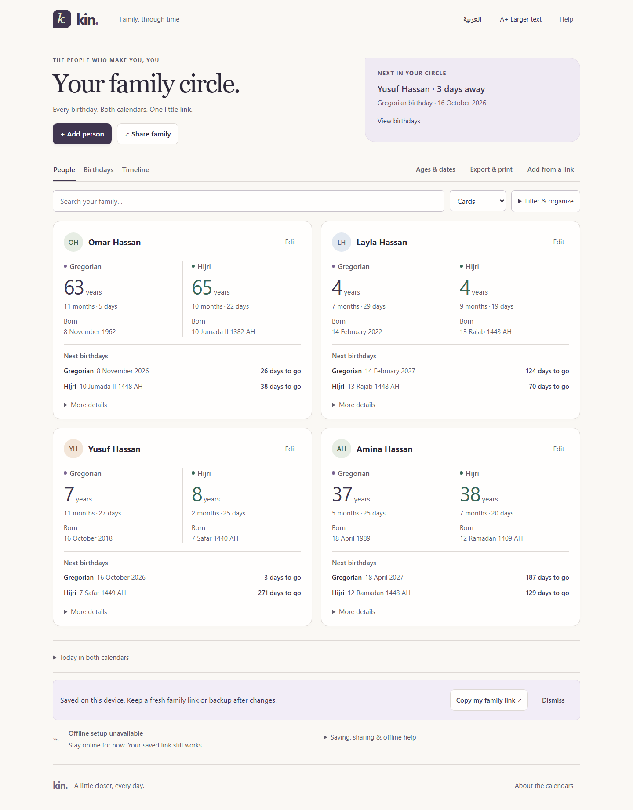

# Kin UI/UX review — 1.2
13 October 2026

**Verdict:** The earlier design had better visual rhythm. Version 1.1 improved readability but made too many controls and boxes equally prominent. Version 1.2 restores warmth and hierarchy while retaining both calendar ages and accessibility improvements.

Open [report.html](report.html) locally for the illustrated report and a three-version comparison. Its companion screenshots are in [assets](assets). The HTML uses only local images; there are no remote fonts or scripts.



## Implemented changes

- Warm ivory background, plum Gregorian ages, sage Hijri ages, varied initials and a serif headline.
- Two main actions: Add and Share. Import, Ages & dates, and Export & print remain available in the utility toolbar.
- A visible next-birthday summary with an action that resets restrictive agenda range/calendar/milestone settings. Existing family filters are retained.
- Lighter cards with prominent numbers, inline months/days, visible birth dates and both upcoming birthdays.
- Clear selected tabs and a combined search/layout/filter area.
- Explanatory export options and consistent dialogs.
- Retained enlarged text, keyboard focus, large touch targets, Arabic reflow and offline features.
- Correct empty-filter feedback and continued access to import before adding a person.

## Measured geometry

Identical synthetic family; Chromium; 13 October 2026; standard text. Desktop 1440×1100; phone 393×851.

| Metric | Earlier 0.8 | Previous 1.1 | Revised 1.2 |
| --- | ---: | ---: | ---: |
| First desktop card height | 358 px | 604 px | 450 px |
| First desktop card top | 684 px | 575 px | 502 px |
| First English phone card top | 803 px | 689 px | 580 px |
| First Arabic phone card top | 808 px | 726 px | 654 px |

The revised desktop card is about 26% shorter than 1.1 without hiding the two calendar ages. The earlier 0.8 card was smaller, but secondary text was too small to recover unchanged. These measurements do not demonstrate faster real-world task completion.

## Verification

- 116 release browser checks passed across desktop/mobile Chromium, Firefox and WebKit; two development-mode checks passed separately.
- Sampled visible card text meets the test thresholds of ≥15 px and ≥4.5:1 contrast. Key controls remain ≥48×48 CSS px.
- English/Arabic narrow-screen and enlarged-text checks, focus restoration and the new birthday shortcut pass.
- Calendar/domain, sharing, restore, concurrent-save protection, offline use and PDF/PNG export checks pass.
- 100,406 calendar round trips pass; dependency audit reports zero vulnerabilities.
- Report comparison controls, image loading and phone reflow were checked.
- Historical captures disable service workers for reproducibility; their offline warning is a capture condition, not a failed production offline check.

This is not a full WCAG audit or participant usability study. Screen-reader, physical-device, native sharing, physical printing and external-calendar checks still need the appropriate devices/products.

## Recommended next steps, in order

1. Observe younger and older family members adding a person, reading both ages, finding a birthday and exporting a calendar. Record hesitation and errors without coaching.
2. Check whether users understand that shared links are snapshots, not synchronized family accounts.
3. Test real Arabic iPhone/Android setups, large system text, screen readers and a printed calendar.
4. Consider denser cards for large families only if observed scrolling becomes a problem. Validate the relationship data model before adding a family tree.

## References and reproducibility

The design uses the [W3C enhanced target-size guidance](https://www.w3.org/WAI/WCAG22/Understanding/target-size-enhanced.html), [contrast guidance](https://www.w3.org/WAI/WCAG22/Understanding/contrast-minimum.html), and [reflow guidance](https://www.w3.org/WAI/WCAG22/Understanding/reflow.html) as references, not as a conformance claim.

With the local release preview running:

```text
node scripts/design-review.mjs before b2c5a4e
node scripts/design-review.mjs original 65d1852
node scripts/design-review.mjs after
node scripts/check-design-report.mjs
npm run test:all
```
